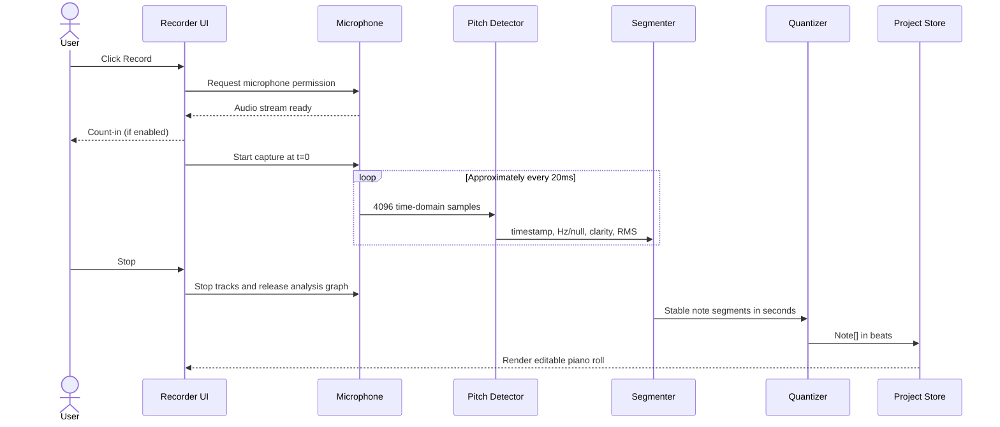

# HumStudio - Software Design Document (SDD)

**Status:** Proposed design; implementation not yet complete  
**Version:** 1.0  
**Date:** 2026-10-09  
**Event:** HackRU Fall 2026  
**Working product name:** HumStudio (rename freely)  
**Audience:** Hackathon developers, reviewers, designers, and AI coding agents

> **Product promise:** Hum a melody, turn it into editable MIDI notes, and hear it played back immediately.
>
> **Scope principle:** Build a convincing voice-to-MIDI music sketchpad, not a professional digital audio workstation (DAW).

## 1. Executive summary

HumStudio is a browser-based, voice-first music composition tool. A user sets a tempo, records a short **monophonic** hum or sung melody, and sees the detected notes appear on a piano-roll timeline. The user can play the transcription with a synthesizer, correct pitches and timing, save/reopen a project, and export MIDI for use in conventional music software.

The project's differentiator is the interface: a person can express a melody with their voice instead of entering notes one at a time. The MVP uses **digital signal processing (DSP)** for pitch detection rather than claiming to train a machine-learning model. A neural pitch model is optional future work, not a dependency for the demo.

### Success scenario

1. Open HumStudio in desktop Chrome over localhost or HTTPS.
2. Choose 120 BPM, click **Record**, and allow microphone access (with a four-beat count-in if the P1 feature is implemented).
3. Hum a clear, 4-8-note melody for approximately 5-10 seconds.
4. Stop recording and see discrete notes on a piano roll.
5. Press **Play** to hear the melody through a synth.
6. Drag one wrong note to a new pitch, then play again.
7. Save the project to a `.humstudio.json` file and/or export a `.mid` file.

## 2. Problem, users, and goals

### Problem statement

Music software expects users to translate ideas into piano-roll clicks, keyboard performances, or recorded instruments. That creates unnecessary friction for someone who can *hear* a melody but cannot play it or program it fluently.

### Target users

- Beginners composing without keyboard or DAW skills.
- Songwriters capturing melodic ideas quickly.
- Producers seeking a fast draft to refine in another DAW.
- Hackathon judges who should understand the concept through one live demonstration.

### Primary goals

- Reduce time from vocal idea to editable notes.
- Make the result visually understandable and musically playable.
- Keep the app reliable under live-demo constraints (unknown microphone, browser permissions, noise).
- Avoid account creation, server setup, API keys, and model downloads for the MVP.

### Non-goals for HackRU MVP

- Polyphonic transcription, chords from voice, or separating vocals from background music.
- Full audio-track editing, waveform comping, effects chains, mixing, or mastering.
- Perfect transcription of vibrato, portamento, fast ornaments, breath sounds, or repeated pitches without clear articulation.
- Training or hosting a custom machine-learning model.
- Cloud collaboration, user accounts, billing, or a full multi-track DAW.

## 3. Scope and priorities

| Tier | Deliverables | Rationale |
|---|---|---|
| **P0 - demo-critical** | Single-track piano roll; synth playback; play/pause/stop/rewind; BPM; mic permission and capture; monophonic pitch detection; note segmentation; configurable quantization; drag notes to change pitch/time; basic note-length edit; local autosave; JSON project export/import; MIDI export | Completes the end-to-end promise and makes the output reusable. |
| **P1 - polish** | Four-beat count-in; audible metronome; manual add/delete; instrument presets; better empty/error states; undo/redo; sample melody preset | Increases demo clarity and resilience. Four-beat count-in may be pulled into P0 if necessary for transcription alignment. |
| **P2 - stretch** | Multiple tracks; Supabase login/cloud saves; uploaded audio; MIDI import; neural pitch model; chord estimation; collaboration | Valuable later, but not required to demonstrate the core product. |

**Scope cut rule:** If the transcription, editing, and playback loop is unstable, cut P1/P2 before attempting new features. When time is tight, allow note duration editing through a numeric control rather than sophisticated edge dragging.

## 4. Functional requirements

| ID | Requirement | Verification |
|---|---|---|
| FR-01 | User can view an 8-bar, 4/4 piano roll spanning at least C3-C6, with vertical scrolling if needed. | Sample notes render at the correct beat and pitch. |
| FR-02 | User can set BPM from 60-180. | Playback tempo changes without modifying note positions. |
| FR-03 | Play, pause, stop, and rewind work; synthesis begins only after user interaction unlocks audio. | A hard-coded C-major phrase plays correctly. |
| FR-04 | User can request microphone access, start and stop capture, and see permission/errors. | Test allow, deny, and missing-device paths. |
| FR-05 | Single-voice humming becomes pitched, timed note objects. | Clean 4-8-note test phrase produces mostly correct pitches. |
| FR-06 | Quantization can be Off, 1/4, 1/8, or 1/16 notes. | Note onsets/ends snap to the selected grid. |
| FR-07 | Notes are editable on the piano roll; minimum pitch/time edits are available. | Drag C4 to D4 and move a note one grid step. |
| FR-08 | The project autosaves locally, and users can export/import the project JSON. | Refresh and file round-trip preserve the notes and tempo. |
| FR-09 | User can export standard MIDI containing the recorded notes at the project tempo. | Open the generated `.mid` in a MIDI-capable app. |
| FR-10 | Microphone tracks are stopped after recording or errors. | Browser recording indicator stops after cleanup. |

## 5. Nonfunctional requirements

- **Target environment:** Desktop Chrome/Edge, modern browser, laptop microphone or headset; localhost/HTTPS. Mobile support is best effort.
- **Performance target:** Short recordings (up to 15 seconds) should normally become notes within 2 seconds of stopping on a typical development laptop. This is a test target, not a guarantee.
- **Audio safety:** User gesture required before starting Tone.js audio; avoid feedback and route the microphone only to analysis, not speakers.
- **Data privacy:** Raw microphone audio remains on device and is not uploaded or persisted by default. Saved project files store **note data**, not audio samples.
- **Reliability:** Microphone denial or weak detection must not crash the editor. A manual/sample-note fallback remains usable.
- **Maintainability:** Pure transformations (Hz to MIDI, segmentation, quantization, serialization) are independent of React and Tone.js.
- **Accessibility:** Visible labels and focusable controls; avoid relying on color alone for recording/playback state.
- **Security:** Treat imported JSON as untrusted: validate it, bound lengths and numbers, and fail without overwriting the current project.

## 6. System context and architecture

```mermaid
flowchart TD
    User[User hums and edits] --> UI[Next.js / React client UI]
    UI --> Mic[Browser getUserMedia]
    Mic --> Frames[Web Audio time-domain frames]
    Frames --> Pitch[Pitchy pitch + clarity]
    Pitch --> Segment[Gate / smooth / segment]
    Segment --> Quantize[Beat conversion / quantization]
    Quantize --> State[Project state: Note array]
    UI <--> State
    State --> Piano[Piano-roll rendering and editing]
    State --> Playback[Tone.js Transport + Synth]
    State --> Save[Local storage + JSON file]
    State --> Midi[@tonejs/midi export]
    Playback --> Out[Audio output]
```

### Architectural boundary

**Client-side only for P0.** Next.js provides the shell; interactive audio/editor code must run in React Client Components or browser-only modules. No API routes are required. Supabase is deliberately excluded until the core flow is proven.

### Component responsibilities

| Component/module | Responsibility | Does not own |
|---|---|---|
| `src/components/StudioClient.tsx` | Compose editor; connect UI actions to project state and services. | Pitch mathematics. |
| `src/components/PianoRoll.tsx` | Render note rectangles and handle pointer-driven edits. | Audio scheduling or persistence. |
| `src/components/TransportControls.tsx` | Display BPM, play/pause/stop/rewind, optional metronome. | Synth internals. |
| `src/components/RecordPanel.tsx` | Permission, recording status, count-in, errors, waveform/pitch feedback. | Final segmentation policy. |
| `src/hooks/useRecorder.ts` | Recording lifecycle and cleanup. | Project state mutations unrelated to recording. |
| `src/lib/audio/mic.ts` | `getUserMedia` stream, AudioContext/AnalyserNode, frame timestamps, teardown. | Note creation. |
| `src/lib/audio/pitch-detector.ts` | Pitchy integration, RMS/clarity thresholding. | UI decisions. |
| `src/lib/audio/segment-notes.ts` | Group noisy pitch observations into note segments. | Timing grid or MIDI bytes. |
| `src/lib/music/quantize.ts` | Translate raw note times to beats and snap to grid. | Recording or playback. |
| `src/lib/audio/tone-engine.ts` | Initialize synth, schedule/clear events, transport lifecycle. | Canonical note data. |
| `src/lib/midi/export-midi.ts` | Convert beat positions to seconds and write `.mid`. | Recording. |
| `src/lib/persistence/local-project.ts` | Validate/store/reopen project JSON. | Audio buffers. |
| `src/state/project-reducer.ts` | Single source of truth for note/project operations. | Browser resource lifecycle. |

### Data flow: capture to MIDI notes



**Important timing rule:** `t=0` is when active recording starts, **after** microphone permission and any count-in. Never include the permission prompt or count-in in the note timestamps.

### Data flow: playback and export

The store retains note pitches and timing **in beats**. The piano roll renders those beats as x coordinates. Tone.js schedules note-on/off events using the current tempo. Export converts beats to seconds (or MIDI ticks) at the project tempo and writes a standard MIDI file. Changing the BPM therefore changes playback/export tempo without altering the saved note arrangement.

## 7. Canonical data model

The following is the shared contract. All developers and agents must use these property names.

```ts
export type QuantizeDivision = "off" | "1/4" | "1/8" | "1/16";

export interface Note {
  id: string;            // Unique within the project
  midi: number;          // Integer 0..127; 60 = C4
  startBeat: number;     // >= 0; zero-based quarter-note beats
  durationBeats: number; // > 0, e.g. 0.5 = eighth note
  velocity: number;      // 0..1
}

export interface Project {
  schemaVersion: 1;
  id: string;
  name: string;
  bpm: number;           // 60..180 in the MVP
  quantize: QuantizeDivision;
  notes: Note[];         // One synth track in MVP
  createdAt: string;     // ISO timestamp
  updatedAt: string;     // ISO timestamp
}
```

**Invariants:** Each note has finite numeric values, `midi` is an integer in 0..127, `startBeat >= 0`, `durationBeats > 0`, and `0 <= velocity <= 1`. Project BPM is finite and 60..180. Notes are sorted by `(startBeat, midi, id)` for deterministic rendering/export. The editor may support overlapping notes via a polyphonic synth even though voice transcription is monophonic.

**Why flat `notes[]`?** It keeps P0 integration easy. The format has a `schemaVersion`, so a later multi-track structure can be introduced with an explicit migration instead of silently changing the contract.

## 8. Audio analysis design

### 8.1 Microphone acquisition

- Use `navigator.mediaDevices.getUserMedia({ audio: { echoCancellation: false, noiseSuppression: false, autoGainControl: false } })` where the browser permits; these are preferences, not promises.
- Create a browser `AudioContext`, a `MediaStreamAudioSourceNode`, and an `AnalyserNode` with `fftSize = 4096`.
- Read a preallocated `Float32Array(4096)` using `getFloatTimeDomainData` roughly every 20 ms while the recorder is active. `requestAnimationFrame` plus an elapsed-time gate is sufficient for MVP; a worklet is a later upgrade.
- Use the **actual** `audioContext.sampleRate` (not a guessed 44.1/48 kHz value).
- Calculate a frame timestamp from `audioContext.currentTime - recordingStartAudioTime`; timestamps reflect approximate analysis-window timing.
- Disconnect graph nodes, stop all `MediaStreamTrack`s, cancel the frame loop, and release the analysis context after recording.

### 8.2 Pitch estimation

- Use `PitchDetector.forFloat32Array(4096)` and `findPitch(buffer, sampleRate)` from Pitchy.
- Pitchy returns estimated fundamental frequency in Hz and a clarity score in `[0,1]`.
- Initial gates (tune using real device tests): clarity >= **0.85**, RMS >= **0.01**, frequency in **80..1000 Hz**. Invalid frames are unvoiced (`hz = null`).
- Convert frequency to continuous MIDI pitch: `69 + 12 * log2(hz / 440)`, then stabilize before rounding to the nearest semitone. A simple strongest-FFT-bin detector is explicitly not recommended because vocal harmonics can exceed the fundamental.

### 8.3 Segmentation

1. Suppress isolated outliers with a sliding median across approximately five valid frames (or similar robust smoothing).
2. Require approximately 60 ms of consistent pitch before opening a note.
3. When a different pitch is stable for approximately 60 ms, close the previous segment and start the next one.
4. Close a note after roughly 80 ms of silence or unvoiced frames.
5. Merge short same-pitch dropout gaps (<= 80 ms) and reject fragments shorter than approximately 100 ms.
6. Preserve the first and last observed voiced timestamps within the recording window.

These constants are **starting heuristics**, not guaranteed-optimal thresholds. Put them in one configuration object to tune during tests. Two consecutive identical-pitch notes are only reliably separable if there is an audible gap or onset evidence; document this limitation rather than fabricating accuracy.

### 8.4 Beat conversion and quantization

For an event with timestamps `startSec` and `endSec` relative to recording start:

```text
startBeat = startSec * bpm / 60
endBeat   = endSec   * bpm / 60
```

A 1/16-note grid is `0.25` quarter-note beats; 1/8 is `0.5`, 1/4 is `1.0`. Snap each boundary to the nearest grid point, then clamp the duration to at least the chosen grid step when quantization is on. When off, retain raw beat timing with a small positive minimum duration. Clamp negative starts to zero and prevent segmentation/rounding from producing invalid note lengths. For a single-voice transcription, prevent **accidental** overlaps created by snapping; deliberate overlaps added by the user can remain.

## 9. Audio playback design

- Initialize audio **only in a user gesture handler**, awaiting `Tone.start()` before playback.
- Use a `Tone.PolySynth` with a simple synthesized voice and one shared `Tone.getTransport()`.
- Set transport BPM from `Project.bpm`; schedule project notes at their beat positions, converting beats to musical ticks/transport positions rather than hard-coding wall-clock seconds.
- Schedule synth triggers with the **precise audio time argument** provided by the transport callback.
- On project updates, stop or safely reschedule the old events. Track the scheduled event IDs and clear them; do not accumulate duplicated notes.
- Pause preserves the playhead position while releasing active voices; Stop halts playback and releases voices. Rewind returns the playhead to beat zero. Also release voices when changing projects or unmounting.
- For MVP, use a fixed 4/4 timeline, no looping or mixed time signatures.

## 10. Piano roll and interaction design

- X position = `startBeat * pixelsPerBeat`; rectangle width = `durationBeats * pixelsPerBeat`.
- Y position = `(highestVisibleMidi - note.midi) * pixelsPerSemitone`.
- Default grid: 8 bars x 4 beats = 32 beats, scrollable; approximately C3 to C6 vertical range.
- Provide grid lines for bars/beats and clearer labels for C notes.
- Drag body horizontally to adjust start beat; drag body vertically to adjust pitch in semitones; drag right edge to adjust duration. Snap horizontal edits to the selected grid (Off = fine movement).
- Keep click-to-select distinct from drag behavior. `pointerdown` -> `pointermove` -> `pointerup`; handle pointer cancellation.
- Prioritize note editing over multi-track panels, fancy waveform art, or a mixing console.

### Proposed state ownership

React owns serializable project data through one reducer/store and immutable actions such as `ADD_NOTES`, `MOVE_NOTE`, `RESIZE_NOTE`, `DELETE_NOTE`, `SET_BPM`, `LOAD_PROJECT`. Audio objects/streams/timers are mutable refs or service instances, **not** stored inside the serializable project.

## 11. Persistence and export

### Project JSON

- Autosave valid project JSON to `localStorage` key `humstudio:project:v1` after a short debounce.
- **Save Project:** download `<safe-name>.humstudio.json`.
- **Open Project:** use an explicit user-selected `.json` file, validate schema/invariants, then replace current project on success only.
- Handle unavailable/blocked/full local storage with a nonfatal UI warning.
- Schema migration is out of scope for MVP; unsupported `schemaVersion` produces a helpful error.

### MIDI

- Instantiate `new Midi()` from `@tonejs/midi`.
- Set the file tempo to `Project.bpm`, add a single track, and convert each beat time/duration to seconds: `seconds = beats * (60 / bpm)`.
- Export `midi.toArray()` as a downloaded `audio/midi` or `application/octet-stream` Blob with `.mid` extension.
- JSON is the **editable HumStudio project**; MIDI is the **interchange format**. MIDI does not preserve UI-only project settings.

## 12. Reliability, failure states, and fallbacks

| Failure | Expected behavior | Demo fallback |
|---|---|---|
| User denies microphone | Clear permission guidance; editor remains functional. | Load sample melody or insert notes manually. |
| No input device / insecure HTTP origin | Show device/HTTPS explanation without crashing. | Demonstrate editor and sample notes. |
| Background noise / poor pitch confidence | Show "No clear melody detected"; preserve project. | Retry in quiet room with headphones; use prepared hum. |
| Audio autoplay restriction | Enable audio on first Play/Record gesture. | Click dedicated "Enable audio" control. |
| Metronome leaks into microphone | Suggest headphones; optionally disable clicks during capture. | Record without audible metronome after count-in. |
| Analyser frame timing jitter | Quantize to beat grid; keep short recordings. | Re-record slower melody. |
| Bad imported JSON | Reject with explanation; never wipe project. | Restore local autosave. |
| Storage quota / private browsing | Offer file export even if autosave fails. | Download JSON before closing page. |

## 13. Testing and evaluation

### Automated checks

- Pure unit tests for `frequencyToMidi`, `secondsToBeats`, grid snapping, segment merging, note invariants, and MIDI export time conversion.
- Round-trip test: project -> JSON -> validated project retains BPM, note count, positions and pitches.
- Regression fixture: time-stamped synthetic `PitchFrame[]` with known notes and artificial one-frame noise.

### Manual test matrix

- Chrome and Edge on a real laptop, speaker and headphone mode.
- Allow/deny mic, stop mid-capture, restart recording, leave page while recording.
- Clean hummed scale; short rests; note repeated with silence; deliberately noisy input.
- BPM 60, 120, 180; quantization Off and 1/16.
- Play, stop, replay, edit a note, replay again; verify no duplicate synth events.
- Save/import JSON and export MIDI; inspect note placement in a MIDI viewer/DAW.

### Definition of done (P0)

A team member can run the app locally, hum a short single-voice melody, receive visible MIDI notes, edit at least one note, hear the edit, save/reopen a project JSON file, and export a valid MIDI file. Permission denial and empty/failed transcription are handled gracefully. The build/lint/type checks pass on the merged branch.

## 14. Engineering milestones and ownership

| Phase | Main deliverable | Dependency |
|---|---|---|
| 1. Contract + scaffold | TypeScript data model; Next.js; hard-coded notes; basic layout | None |
| 2. Editor + playback | Piano roll, transport, BPM and synth | Shared note contract |
| 3. Capture + analysis | Mic input, Pitchy frames, clear statuses | Browser setup |
| 4. Segmentation + quantization | `PitchFrame[] -> Note[]` working with fixtures | Pitch-frame contract |
| 5. Integration | Recording inserts notes into the piano roll; playback works | Phases 2-4 |
| 6. Finish | JSON persistence, MIDI export, tests, deploy, demo rehearsal | Stable main workflow |

Suggested ownership: **UI/editor**, **Tone.js playback**, **capture/transcription**, and **integration/export/test**. Work in parallel behind the data interfaces in `TECHNICAL_SPEC.md`.

## 15. Risks and architectural decisions

| Decision | Choice | Why |
|---|---|---|
| ADR-001 | Client-only audio/DSP | No network latency, API keys, or backend dependencies; better privacy. |
| ADR-002 | Pitchy over strongest-bin FFT | Handles fundamental estimation more robustly for monophonic voice. |
| ADR-003 | Store note time in beats | BPM changes do not distort arrangement positions. |
| ADR-004 | Flat `Project.notes[]` in v1 | Fast integration; future multi-track migration remains possible. |
| ADR-005 | Local JSON + MIDI before Supabase | Demonstrable persistence/export without auth or cloud setup. |
| ADR-006 | Desktop Chrome/Edge first | Limit browser variability during a weekend build. |
| ADR-007 | DSP terminology is accurate | Do not advertise model training or neural AI that is not implemented. |

## 16. Future iterations (not HackRU commitments)

- Separate `Track[]` schema with per-track instruments, muting, and arrangement.
- MIDI import, keyboard input, scale overlays, chord suggestions, pitch confidence visualization.
- Offline audio-file analysis and higher-fidelity onset detection for repeated notes.
- Optional neural pitch model, evaluated against the deterministic DSP baseline.
- Supabase auth/project syncing only after privacy, access rules, and migration are designed.

## 17. Companion documents and references

- [`TECHNICAL_SPEC.md`](TECHNICAL_SPEC.md) - implementable interfaces, algorithms, edge cases, and acceptance tests.
- [`AGENTS.md`](AGENTS.md) - coding-agent and contributor rules.
- [`README.md`](README.md) - user/developer entry point and project status.

Technical references (accessed 2026-10-09):

- [Pitchy README and usage](https://github.com/ianprime0509/pitchy)
- [Tone.js transport and audio](https://tonejs.github.io/)
- [Tone MIDI library](https://github.com/Tonejs/Midi)
- [Next.js Client Components](https://nextjs.org/docs/app/getting-started/server-and-client-components)
- [MDN getUserMedia and secure contexts](https://developer.mozilla.org/en-US/docs/Web/API/MediaDevices/getUserMedia)
