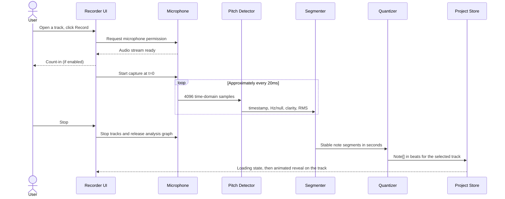

# HumStudio - Software Design Document (SDD)

**Status:** Studio UI and deterministic melodic generation implemented; real-microphone tuning, editing, and persistence pending
**Version:** 1.1 (multi-track revision)
**Date:** 2026-10-10
**Event:** HackRU Fall 2026  
**Working product name:** HumStudio (rename freely)  
**Audience:** Hackathon developers, reviewers, designers, and AI coding agents

> **Product promise:** Pick an instrument, hum a melody, and watch that track fill with music you can play back and export.
>
> **Scope principle:** Build a convincing hum-to-music sketchpad with a familiar multi-track layout, not a professional digital audio workstation (DAW).

> [`PRODUCT.md`](PRODUCT.md) made **multi-track core**: one track per instrument, click a track to zoom, record a hum with a live spectrogram, a loading state, then an animated note reveal. That UI now exists. Output is a **generated part for the selected instrument**, not necessarily a 1:1 transcription: local DSP segmentation in `src/lib/audio/segment-notes.ts` feeds instrument/harmony fitting and quantization in `src/lib/generate.ts`. Anything not built yet is marked *planned*.

## 1. Executive summary

HumStudio is a browser-based, voice-first music composition tool laid out like a familiar DAW: five instrument tracks (Melody, Bass, Keys, Drums, Strings) over an 8-bar 4/4 timeline. The user opens a track, records a short **monophonic** hum, watches a live spectrogram print across the lane, and sees generated notes for that instrument revealed on the track. The arrangement plays through Tone.js with mute/solo and exports as multi-track MIDI. Note editing and project save/reopen are planned.

The project's differentiator is the interface: a person can express a melody with their voice instead of entering notes one at a time. Pitch detection is **digital signal processing (DSP)** via Pitchy. The current generator is a placeholder heuristic; do not describe it as a trained model. A real generator (transcription and/or arrangement, possibly a backend) replaces `generateTrack(...)` later.

### Success scenario

1. Open HumStudio in desktop Chrome over localhost or HTTPS and see five instrument tracks (Keys and Drums hold labeled sample parts).
2. Click the **Melody** track; it zooms and floods with its color.
3. Click **Record**, allow microphone access, and hum a clear 4-8-note melody for about 5-10 seconds while the spectrogram prints live.
4. Stop. A "Setting the session" loading state runs, then the generated notes set in left to right over a ghost of the hum.
5. Return to all tracks and press **Play** to hear the arrangement; mute/solo tracks.
6. *(Planned)* Drag one wrong note to a new pitch, then play again.
7. Export a `.mid` file; *(planned)* save the project to a `.humstudio.json` file.

## 2. Problem, users, and goals

### Problem statement

Music software expects users to translate ideas into piano-roll clicks, keyboard performances, or recorded instruments. That creates unnecessary friction for someone who can *hear* a melody but cannot play it or program it fluently.

### Target users

- Beginners composing without keyboard or DAW skills.
- Songwriters capturing melodic ideas quickly.
- Producers seeking a fast draft to refine in another DAW.
- Hackathon judges who should understand the concept through one live demonstration.

### Primary goals

- Reduce time from vocal idea to editable notes.
- Make the result visually understandable and musically playable.
- Keep the app reliable under live-demo constraints (unknown microphone, browser permissions, noise).
- Avoid account creation, server setup, API keys, and model downloads for the MVP.

### Non-goals for HackRU MVP

- Polyphonic transcription, chords from voice, or separating vocals from background music.
- Full audio-track editing, waveform comping, effects chains, mixing, or mastering.
- Perfect transcription of vibrato, portamento, fast ornaments, breath sounds, or repeated pitches without clear articulation.
- Training or hosting a custom machine-learning model.
- Cloud collaboration, user accounts, or billing.
- A full DAW: no audio tracks, mixer, or arbitrary track creation. The five instrument tracks are fixed.

## 3. Scope and priorities

| Tier | Deliverables | Rationale |
|---|---|---|
| **P0 - demo-critical** | Five-instrument arrangement view **(built)**; click-to-zoom track **(built)**; mic permission and capture with live spectrogram **(built)**; loading state and animated note reveal **(built)**; Tone.js playback of all tracks with mute/solo, BPM, play/pause/stop/rewind **(built)**; multi-track MIDI export **(built)**; demo-hum fallback and error states **(built)**; deterministic melodic generation (pitch, segmentation, quantization) **(built; real-device tuning pending)**; drag notes to change pitch/time and basic length edit *(planned)*; local autosave and JSON project export/import for all tracks *(planned)* | Completes the end-to-end promise and makes the output reusable. |
| **P1 - polish** | Four-beat playback count-in and metronome **(built; listening pending)**; recording count-in with click **(built; listening pending)**; manual add/delete; undo/redo; instrument sound polish; confirm before overwriting a generated part | Increases demo clarity and resilience. |
| **P2 - stretch** | Generation backend or ML arrangement model; Supabase login/cloud saves; uploaded audio; MIDI import; chord estimation; user-created tracks; collaboration | Valuable later, but not required to demonstrate the core product. |

**Scope cut rule:** If the transcription, editing, and playback loop is unstable, cut P1/P2 before attempting new features. When time is tight, allow note duration editing through a numeric control rather than sophisticated edge dragging.

## 4. Functional requirements

| ID | Requirement | Verification |
|---|---|---|
| FR-01 | User sees five instrument tracks over an 8-bar, 4/4 timeline; each zoomed track shows its own pitch range (e.g. Melody C4-C6, Bass E1-E3) or drum rows. **Built.** | Sample notes render at the correct beat and pitch. |
| FR-02 | User can set BPM from 60-180. **Built** (default 120). | Playback tempo changes without modifying note positions. |
| FR-03 | Play, Pause (preserves position), Stop (resets to zero), and Rewind work; synthesis begins only after a click unlocks audio. **Built.** | Sample Keys + Drums play in time. |
| FR-04 | User can open a track, request microphone access, start and stop capture, and see permission/errors. **Built.** | Test allow, deny, insecure origin, and missing-device paths. |
| FR-05 | A single-voice hum becomes timed notes for the selected instrument. *Mock generator today.* | Clean 4-8-note phrase produces mostly correct pitches in the instrument's range. |
| FR-06 | Quantization can be Off, 1/4, 1/8, or 1/16 notes. **Built** (default 1/16). | Note onsets/ends snap to the selected grid. |
| FR-07 | Notes are editable in the zoomed track; minimum pitch/time edits are available. *Planned.* | Drag C4 to D4 and move a note one grid step. |
| FR-08 | The project (all tracks) autosaves locally, and users can export/import project JSON. *Planned.* | Refresh and file round-trip preserve every track, BPM, and mute/solo. |
| FR-09 | User can export standard MIDI with one track per instrument at the project tempo. **Built.** | Open the `.mid` in a MIDI-capable app; drums on channel 10. |
| FR-10 | Microphone tracks are stopped after recording, errors, or unmount. **Built.** | Browser recording indicator stops after cleanup. |
| FR-11 | While recording, a live spectrogram draws over the zoomed track; a loading state covers generation; notes are revealed with an animation (skipped under reduced motion). **Built.** | Visual check; reduced-motion check. |
| FR-12 | Mic failure or an empty take shows a clear message and a labeled **Demo hum** option; existing notes are never erased. **Built.** | Deny permission, then record silence. |

## 5. Nonfunctional requirements

- **Target environment:** Desktop Chrome/Edge, modern browser, laptop microphone or headset; localhost/HTTPS. Mobile support is best effort.
- **Performance target:** Short recordings (up to 15 seconds) should normally become notes within 2 seconds of stopping on a typical development laptop. This is a test target, not a guarantee.
- **Audio safety:** User gesture required before starting Tone.js audio; avoid feedback and route the microphone only to analysis, not speakers.
- **Data privacy:** Raw microphone audio remains on device and is not uploaded or persisted by default. Saved project files store **note data**, not audio samples.
- **Reliability:** Microphone denial or weak detection must not crash the editor. The labeled Demo hum and sample parts remain usable.
- **Maintainability:** Pure transformations (Hz to MIDI, segmentation, quantization, serialization) are independent of React and Tone.js.
- **Accessibility:** Visible labels and focusable controls; recording/playback/mute/solo state never conveyed by color alone; reduced motion skips the reveal choreography.
- **Security:** Treat imported JSON as untrusted: validate it, bound lengths and numbers, and fail without overwriting the current project.

## 6. System context and architecture

```mermaid
flowchart TD
    User[User hums and edits] --> UI[Next.js / React client UI]
    UI --> Mic[Browser getUserMedia]
    Mic --> Frames[Web Audio time-domain frames]
    Frames --> Pitch[Pitchy pitch + clarity]
    Frames --> Spec[Spectrogram bins, display only]
    Pitch --> Gen[generateTrack: segment / quantize / fit to instrument]
    Gen --> State[Studio state: Track array]
    UI <--> State
    State --> Piano[Track lanes: render, reveal, edit planned]
    State --> Playback[Tone.js Transport + smplr / synth fallback]
    State --> Save[Local storage + JSON file]
    State --> Midi[@tonejs/midi export]
    Playback --> Out[Audio output]
```

### Architectural boundary

**Client-side today.** Next.js provides the shell; interactive audio/editor code runs in Client Components (`'use client'`) or browser-only modules. No API routes exist. A future generation backend plugs in behind `generateTrack(...)`; if it is remote, sending audio or pitch data off-device needs an explicit team decision and user consent (see privacy). Supabase is deliberately excluded until the core flow is proven.

### Component responsibilities

| Component/module | Responsibility | Status |
|---|---|---|
| `src/components/Studio.tsx` | App shell: transport bar, ruler, row layout, canonical `Track[]` state, record → generate → reveal flow, playhead. | Built |
| `src/components/TrackRow.tsx` | One track: arrangement clip or zoomed lane with prompts, phases, pitch labels, note reveal. | Built (note editing planned) |
| `src/components/Spectrogram.tsx` | Live halftone canvas of the hum on the lane's pitch axis. Display only. | Built |
| `src/lib/tracks.ts` | `Instrument`, `Track`, `INSTRUMENTS`, labeled sample parts, lane geometry helpers. | Built (shared contract) |
| `src/lib/hum.ts` | `getUserMedia`, AnalyserNode, Pitchy pitch/RMS gating, `HumFrame` stream, demo hum, teardown, mic error messages. | Built (needs real-mic testing) |
| `src/lib/generate.ts` | `generateTrack(instrument, frames, bpm, quantize, harmony) → Promise<Note[]>`; pure `generateNotes` for fixtures. | Built (DSP heuristics; real-device tuning pending) |
| `src/lib/playback.ts` | Browser-only facade for scheduling, play/pause/stop/rewind/position, metronome, count-in, and teardown; delegates to `src/lib/audio/`. | Built (playback regression tests; listening pending) |
| `src/lib/midi.ts` | `Track[]` → multi-track `.mid` download. | Built |
| `src/lib/music/types.ts` | Shared `Note`/`QuantizeDivision` contract. `Project`/`PitchFrame` and shared timing/grid helpers remain targets; implemented segment types live in `audio/segment-notes.ts`. | Built (`Note` only) |
| `src/lib/audio/segment-notes.ts` | Stabilize gated `HumFrame` pitch into second-based segments with rest boundaries. | Built (synthetic regression fixtures; real-device tuning pending) |
| `src/lib/persistence/local-project.ts` | Validate/store/reopen multi-track project JSON. | Planned |

### Data flow: capture to MIDI notes



**Important timing rule:** `t=0` is when active recording starts, **after** microphone permission and any count-in. Never include the permission prompt or count-in in the note timestamps.

### Data flow: playback and export

The store retains note pitches and timing **in beats**, per track. Lanes render those beats as x coordinates.Tone.js schedules note-on/off events using the current tempo. Export converts beats to seconds (or MIDI ticks) at the project tempo and writes a standard MIDI file. Changing the BPM therefore changes playback/export tempo without altering the saved note arrangement.

## 7. Canonical data model

The following is the shared contract (`src/lib/music/types.ts`). All developers and agents must use these property names. The multi-track app state built on top of it follows the code block.

```ts
export type QuantizeDivision = "off" | "1/4" | "1/8" | "1/16";

export interface Note {
  id: string;            // Unique within the project
  midi: number;          // Integer 0..127; 60 = C4
  startBeat: number;     // >= 0; zero-based quarter-note beats
  durationBeats: number; // > 0, e.g. 0.5 = eighth note
  velocity: number;      // 0..1
}

export interface Project {
  schemaVersion: 1;
  id: string;
  name: string;
  bpm: number;           // 60..180 in the MVP
  quantize: QuantizeDivision;
  notes: Note[];         // One synth track in MVP
  createdAt: string;     // ISO timestamp
  updatedAt: string;     // ISO timestamp
}
```

**Invariants:** Each note has finite numeric values, `midi` is an integer in 0..127, `startBeat >= 0`, `durationBeats > 0`, and `0 <= velocity <= 1`. Project BPM is finite and 60..180. Notes are sorted by `(startBeat, midi, id)` for deterministic rendering/export. The editor may support overlapping notes via a polyphonic synth even though voice transcription is monophonic.

**App state is multi-track.** `src/lib/tracks.ts` defines:

```ts
interface Instrument { id: string; name: string; color: string; lo: number; hi: number; kind: "synth" | "drums"; hint: string }
interface Track { instrument: Instrument; presetId: string; notes: Note[]; muted: boolean; solo: boolean; sample: boolean }
```

`Studio.tsx` holds `Track[]` (one per instrument in `INSTRUMENTS`), plus `bpm` and `quantize`. `sample: true` marks preset parts shown with a "Sample" label until a recording replaces them. Drum notes use General MIDI kit numbers (36 kick, 38 snare, 42 closed hat, 46 open hat, 49 crash).

**Saved format is not decided yet.** `Project` v1 above stores one flat `notes[]`. Saving the multi-track arrangement needs a versioned format (for example `schemaVersion: 2` with `tracks: { instrumentId, presetId, notes, muted, solo }[]`) with an explicit migration from v1. Missing legacy preset IDs receive category defaults; unknown/cross-category selections reject. Person 4 owns this decision ([`WORKLOAD_SPLIT.md`](WORKLOAD_SPLIT.md)); do not silently change `Project` v1.

## 8. Audio analysis design

### 8.1 Microphone acquisition

- Use `navigator.mediaDevices.getUserMedia({ audio: { echoCancellation: false, noiseSuppression: false, autoGainControl: false } })` where the browser permits; these are preferences, not promises.
- Create a browser `AudioContext`, a `MediaStreamAudioSourceNode`, and an `AnalyserNode` with `fftSize = 4096`.
- Read time-domain and frequency data every animation frame while recording (`src/lib/hum.ts`; a ~20 ms elapsed-time gate or an AudioWorklet are later refinements). Frequency data feeds the 48-bin spectrogram display only.
- Use the **actual** `audioContext.sampleRate` (not a guessed 44.1/48 kHz value).
- Timestamp each frame relative to recording start (`hum.ts` currently uses `performance.now()`; `audioContext.currentTime` is the more accurate option). Timestamps reflect approximate analysis-window timing.
- Disconnect graph nodes, stop all `MediaStreamTrack`s, cancel the frame loop, and release the analysis context after recording.

### 8.2 Pitch estimation

- Use `PitchDetector.forFloat32Array(4096)` and `findPitch(buffer, sampleRate)` from Pitchy.
- Pitchy returns estimated fundamental frequency in Hz and a clarity score in `[0,1]`.
- Initial gates (tune using real device tests): clarity >= **0.85**, RMS >= **0.01**, frequency in **80..1000 Hz**. Invalid frames are unvoiced (`hz = null`).
- Convert frequency to continuous MIDI pitch: `69 + 12 * log2(hz / 440)`, then stabilize before rounding to the nearest semitone. A simple strongest-FFT-bin detector is explicitly not recommended because vocal harmonics can exceed the fundamental.

### 8.3 Segmentation

1. Suppress isolated outliers with a sliding median across approximately five valid frames (or similar robust smoothing).
2. Require 120 ms of consistent pitch before opening a note; retain the active/candidate pitch within a 0.7-semitone hold region to suppress vibrato.
3. When a different pitch is stable for 120 ms, close the previous segment and start the next one at the candidate onset.
4. Preserve pitch history across unvoiced gaps <= 150 ms. Longer silence closes at the last voiced frame and marks a new phrase; missing-frame gaps also separate phrases. Thresholds are measured in seconds independently of BPM.
5. Melody retains confirmed rounded pitches and defines harmony after the take; other melodic parts fit that harmony. Merge identical pitches within the same phrase before snapping. Confirmed rests still separate notes. Reject fragments shorter than 100 ms in Medium.
6. Preserve the first and last observed voiced timestamps within the recording window.

These Medium values remain the default. The top-menu Sensitivity select adds Low (1.5-semitone hold, 200 ms stability, seven-frame median) and High (0.5-semitone hold, 60 ms stability/minimum note, three-frame median). All levels retain 150 ms silence hold. Edit profiles together in `src/lib/audio/note-sensitivity.ts`; `SEGMENTATION_DEFAULTS` uses Medium. Changing selection affects future melodic takes, preserving existing notes; it does not alter drum onsets or rhythm snapping. These are **starting heuristics**, not guaranteed-optimal thresholds. Real-device tuning and future onset detection are still needed for very fast repeated notes and short rests.

### 8.4 Beat conversion and quantization

For an event with timestamps `startSec` and `endSec` relative to recording start:

```text
startBeat = startSec * bpm / 60
endBeat   = endSec   * bpm / 60
```

A 1/16-note grid is `0.25` quarter-note beats; 1/8 is `0.5`, 1/4 is `1.0`. Snap each boundary to the nearest grid point, then clamp the duration to at least the chosen grid step when quantization is on. When off, retain raw beat timing with a small positive minimum duration. Clamp negative starts to zero and prevent segmentation/rounding from producing invalid note lengths. For a single-voice transcription, prevent **accidental** overlaps created by snapping; deliberate overlaps added by the user can remain.

## 9. Audio playback design

- Initialize audio **only in a user gesture handler**, awaiting `Tone.start()` before playback.
- Instrument voices on one shared `Tone.getTransport()`: smplr presets on Tone's underlying audio context, with the existing `PolySynth`/percussion sounds retained as fallback. Expanded tracks select their own serializable `presetId` without changing notes. Lazy loading, stale-request guards, and shared buffer reuse live in `preset-manager.ts`/`smplr-backend.ts`. Unique per-attack stop handles preserve overlapping equal pitches. Kit-specific aliases play the same GM drum notes; regular note-offs leave one-shots intact. Mute/solo are applied at schedule time.
- Set transport BPM from the canonical studio BPM state; schedule track notes at their beat positions, converting beats to musical ticks/transport positions rather than hard-coding wall-clock seconds.
- Schedule synth triggers with the **precise audio time argument** provided by the transport callback.
- On project updates, stop or safely reschedule the old events. Track the scheduled event IDs and clear them; do not accumulate duplicated notes.
- Pause preserves the playhead position while releasing active voices; Stop halts playback, releases voices, and resets to zero. Rewind returns the playhead to beat zero while preserving running/paused state. Also release voices when changing projects or unmounting.
- Optional metronome and four-beat count-in use the audio clock. Count-in precedes playback and recording; while recording, only the click plays.
- Fixed 4/4 timeline. The transport loops the 8-bar arrangement; no mixed time signatures.

## 10. Track lanes and interaction design

- **Arrangement view:** five rows share the viewport height; each row is a flood-colored header (name, M/S) plus a lane with a bar/beat grid. Generated parts render as solid flood clips with ink note bars; sample parts render outlined.
- **Zoomed view:** clicking a row zooms it; the others collapse to 36 px strips. The zoomed lane fills with the instrument color, labels C rows (or drum names), and hosts recording, spectrogram, loading, and reveal.
- Geometry is derived, never stored: x = `startBeat / 32` of lane width; y = `(instrument.hi - midi) / rows` of lane height (`src/lib/tracks.ts`).
- 8 bars x 4 beats = 32 beats, fitted to the viewport width (no horizontal scroll yet).
- Grid lines for bars/beats and labels for C notes.

**Editing (planned, Person 3):**

- Drag body horizontally to adjust start beat; drag body vertically to adjust pitch in semitones; drag right edge to adjust duration. Snap horizontal edits to the selected grid (Off = fine movement).
- Keep click-to-select distinct from drag behavior. `pointerdown` -> `pointermove` -> `pointerup`; handle pointer cancellation.
- Prioritize note editing over a mixing console or extra visual effects.

### Proposed state ownership

Today `Studio.tsx` owns `Track[]`, BPM, and quantize in React state and replaces arrays immutably. As editing and persistence land, move to one reducer with track-scoped actions such as `REPLACE_TRACK_NOTES`, `MOVE_NOTE`, `RESIZE_NOTE`, `DELETE_NOTE`, `TOGGLE_MUTE`, `SET_BPM`, `LOAD_PROJECT`. Audio objects/streams/timers stay in refs or service modules, **not** in serializable state.

## 11. Persistence and export

### Project JSON (planned)

- Save **all tracks** (instrument id, notes, mute/solo) plus BPM and quantize, in the versioned multi-track format from section 7.
- Autosavevalid project JSON to `localStorage` key `humstudio:project:v1` after a short debounce.
- **Save Project:** download `<safe-name>.humstudio.json`.
- **Open Project:** use an explicit user-selected `.json` file, validate schema/invariants, then replace current project on success only.
- Handle unavailable/blocked/full local storage with a nonfatal UI warning.
- Schema migration is out of scope for MVP; unsupported `schemaVersion` produces a helpful error.

### MIDI

- Instantiate `new Midi()` from `@tonejs/midi`.
- Set the file tempo to the project BPM, add **one MIDI track per non-empty instrument track** (Drums on channel 10), and convert each beat time/duration to seconds: `seconds = beats * (60 / bpm)`. Implemented in `src/lib/midi.ts`; downloads as `humstudio.mid`.
- Export `midi.toArray()` as a downloaded `audio/midi` or `application/octet-stream` Blob with `.mid` extension.
- JSON is the **editable HumStudio project**; MIDI is the **interchange format**. MIDI does not preserve UI-only project settings.

## 12. Reliability, failure states, and fallbacks

| Failure | Expected behavior | Demo fallback |
|---|---|---|
| User denies microphone | Clear permission guidance in the zoomed track; editor remains functional. | **Demo hum** (labeled) or sample parts. |
| No input device / insecure HTTP origin | Show device/HTTPS explanation without crashing. | Demo hum; sample Keys/Drums. |
| Background noise / poor pitch confidence | "We didn't catch a hum..."; existing notes preserved. | Retry in a quiet room with headphones; Demo hum. |
| Generator returns no notes or throws | Error state with retry; existing notes preserved. | Demo hum. |
| Audio autoplay restriction | Enable audio on first Play/Record gesture. | Click dedicated "Enable audio" control. |
| Metronome leaks into microphone | Suggest headphones; optionally disable clicks during capture. | Record without audible metronome after count-in. |
| Analyser frame timing jitter | Quantize to beat grid; keep short recordings. | Re-record slower melody. |
| Bad imported JSON | Reject with explanation; never wipe project. | Restore local autosave. |
| Storage quota / private browsing | Offer file export even if autosave fails. | Download JSON before closing page. |

## 13. Testing and evaluation

### Automated checks

- Implemented: 77 regression tests using TypeScript and Node's built-in test runner, covering playback (23), preset loading/voices (14), harmony (6), segmentation (12), generation (11), and sensitivity (11). Fixtures include short wobbles/dropouts, real rests, the three sensitivity profiles, preserved Melody semitone changes, tempo independence, Off timing, invalid input, duplicate metronome ticks, stale loads, fallback/retry, and sample lifetimes. Preset browser evidence and remaining human checks are documented in [`SMPLR_INTEGRATION.md`](SMPLR_INTEGRATION.md).
- Target: pure unit tests for `frequencyToMidi`, `secondsToBeats`, grid snapping, segment merging, note invariants, and MIDI export time conversion.
- Target: round-trip test where project -> JSON -> validated project retains BPM, note count, positions and pitches.
- Implemented: time-stamped synthetic `HumFrame[]` fixtures with known pitches, vibrato, short noise, and dropouts.

### Manual test matrix

- Chrome and Edge on a real laptop, speaker and headphone mode.
- Allow/deny mic, stop mid-capture, restart recording, leave page while recording.
- Clean hummed scale; short rests; note repeated with silence; deliberately noisy input.
- BPM 60, 120, 180; quantization Off and 1/16.
- Play, stop, replay, edit a note, replay again; verify no duplicate synth events.
- Save/import JSON and export MIDI; inspect note placement in a MIDI viewer/DAW.

### Definition of done (P0)

A team member can run the app locally, open a track, hum a short single-voice melody, see generated notes revealed on that track, edit at least one note, hear the arrangement, save/reopen a project JSON file, and export a valid multi-track MIDI file.Permission denial and empty/failed transcription are handled gracefully. The build/lint/type checks pass on the merged branch.

## 14. Engineering milestones and ownership

| Phase | Main deliverable | Dependency |
|---|---|---|
| 1. Contract + scaffold | TypeScript data model; Next.js; sample parts; studio layout **(done)** | None |
| 2. Studio + playback | Tracks, zoom, transport, BPM, synths, MIDI export, record/spectrogram/reveal flow **(done)** | Shared note contract |
| 3. Capture + analysis | Mic input, Pitchy frames, clear statuses | Browser setup |
| 4. Segmentation + quantization | `HumFrame[] -> Note[]` working with fixtures **(done; real-microphone tuning pending)** | HumFrame contract |
| 5. Integration | Real `generateTrack` output lands on the selected track; notes editable; arrangement plays | Phases 2-4 |
| 6. Finish | JSON persistence, MIDI export, tests, deploy, demo rehearsal | Stable main workflow |

Ownership is assigned in [`WORKLOAD_SPLIT.md`](WORKLOAD_SPLIT.md): **voice-to-notes**, **playback/transport**, **track editor**, and **integration/branding/persistence**. Work in parallel behind the interfaces in `TECHNICAL_SPEC.md`.

## 15. Risks and architectural decisions

| Decision | Choice | Why |
|---|---|---|
| ADR-001 | Client-only audio/DSP | No network latency, API keys, or backend dependencies; better privacy. |
| ADR-002 | Pitchy over strongest-bin FFT | Handles fundamental estimation more robustly for monophonic voice. |
| ADR-003 | Store note time in beats | BPM changes do not distort arrangement positions. |
| ADR-004 | Flat `Project.notes[]` in the v1 contract; app state is `Track[]` | v1 contract stays stable; the multi-track save format gets a new version (v2) rather than a silent change. |
| ADR-005 | Local JSON + MIDI before Supabase | Demonstrable persistence/export without auth or cloud setup. |
| ADR-006 | Desktop Chrome/Edge first | Limit browser variability during a weekend build. |
| ADR-007 | DSP terminology is accurate | Do not advertise model training or neural AI that is not implemented. |
| ADR-008 | Multi-track instrument editor is P0 | `PRODUCT.md`: the demo is "pick an instrument, hum, watch it fill"; overrides the original single-track P0. |
| ADR-009 | Generation behind one function (`generateTrack`) | Keep the UI independent of DSP implementation or a future generation backend. |

## 16. Future iterations (not HackRU commitments)

- User-created tracks, per-track volume/instrument choice, and arrangements longer than 8 bars.
- MIDI import, keyboard input, scale overlays, chord suggestions, pitch confidence visualization.
- Offline audio-file analysis and higher-fidelity onset detection for repeated notes.
- Optional neural pitch model, evaluated against the deterministic DSP baseline.
- Supabase auth/project syncing only after privacy, access rules, and migration are designed.

## 17. Companion documents and references

- [`TECHNICAL_SPEC.md`](TECHNICAL_SPEC.md) - implementable interfaces, algorithms, edge cases, and acceptance tests.
- [`AGENTS.md`](AGENTS.md) - coding-agent and contributor rules.
- [`PRODUCT.md`](PRODUCT.md) - product context; [`DESIGN.md`](DESIGN.md) - visual system; [`WORKLOAD_SPLIT.md`](WORKLOAD_SPLIT.md) - team ownership.
- [`README.md`](README.md) - user/developer entry point and project status.

Technical references (accessed 2026-10-09):

- [Pitchy README and usage](https://github.com/ianprime0509/pitchy)
- [Tone.js transport and audio](https://tonejs.github.io/)
- [Tone MIDI library](https://github.com/Tonejs/Midi)
- [Next.js Client Components](https://nextjs.org/docs/app/getting-started/server-and-client-components)
- [MDN getUserMedia and secure contexts](https://developer.mozilla.org/en-US/docs/Web/API/MediaDevices/getUserMedia)
